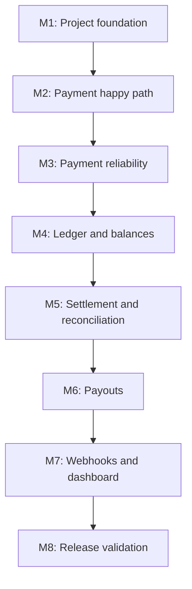

# Moneytrail Release 01 Milestones

Complete the milestones in order. Check off a milestone only when its integration test and "done when" condition pass.

## M1: Project foundation

- [ ] Create the Spring Boot and Maven project with clear modules or packages for the main system parts.
- [ ] Add Docker Compose for Postgres and Kafka.
- [ ] Add database migrations and seed a few synthetic merchants.
- [ ] Add a health endpoint and structured logging with tracking IDs.
- [ ] Add a Testcontainers smoke test that starts the application with real Postgres.

**Done when:** a clean checkout can start the dependencies, run the application, and pass the smoke test.

## M2: Payment happy path

- [ ] Create the payment table and payment state model.
- [ ] Build the mock PSP with successful authorization and capture responses.
- [ ] Implement create payment, get payment, and capture payment APIs.
- [ ] Validate merchant, order ID, positive minor-unit amount, and currency.
- [ ] Add an integration test covering creation, authorization, capture, and status lookup.

**Done when:** one merchant payment moves from creation to captured and every state is visible through the API.

## M3: Payment reliability

- [ ] Store idempotency keys per merchant with a fingerprint of the original request.
- [ ] Return the original payment for an identical retry and reject a conflicting retry.
- [ ] Add PSP refusal, timeout, duplicate callback, out-of-order callback, and lost-response modes.
- [ ] Record an uncertain capture as `UNKNOWN` and resolve it through PSP status lookup.
- [ ] Save payment changes and outgoing events together through a transactional outbox.

**Done when:** automated tests prove that retries and uncertain provider responses never create a second payment or
capture.

## M4: Ledger and merchant balances

- [ ] Create append-only ledger transaction, account, and entry tables.
- [ ] Consume captured-payment events and deduplicate them by event ID.
- [ ] Post balanced provider-receivable and merchant-payable entries for each capture.
- [ ] Calculate `PENDING`, `AVAILABLE`, `RESERVED`, and `PAID` merchant balances from ledger entries.
- [ ] Test duplicate events, temporary ledger failure, catch-up, and rebuilding balances from history.

**Done when:** every captured payment is posted exactly once, every transaction balances, and balances can be rebuilt.

## M5: Settlement and reconciliation

- [ ] Generate and import synthetic PSP settlement reports.
- [ ] Prevent the same report or report line from being imported twice.
- [ ] Match report lines to captured payments and detect missing, duplicate, extra, or incorrect lines.
- [ ] Move matched funds from `PENDING` to `AVAILABLE` with balanced ledger entries.
- [ ] Expose unresolved reconciliation exceptions and keep mismatched funds unavailable.

**Done when:** a correct report releases funds and an incorrect report produces a visible exception without releasing
them.

## M6: Payouts

- [ ] Implement payout creation and status lookup.
- [ ] Reserve available merchant funds atomically before calling the mock bank.
- [ ] Prevent concurrent payouts from spending the same balance.
- [ ] Add mock-bank success, failure, timeout, and lost-response modes.
- [ ] Resolve uncertain payouts by bank-reference lookup and post the corresponding ledger entries.

**Done when:** a merchant can be paid once, insufficient or already-reserved funds cannot be spent, and a lost response
cannot create a second transfer.

## M7: Webhooks and dashboard

- [ ] Send signed merchant webhooks with retries and delivery history.
- [ ] Add the Payments view for payment state and history.
- [ ] Add the Funds view for pending, available, reserved, and paid balances.
- [ ] Add the operator view for reconciliation exceptions and unresolved operations.
- [ ] Add one trace view connecting payment, events, ledger entries, settlement, payout, and webhook deliveries.

**Done when:** merchants can inspect only their own activity and an operator can follow one payment through the entire
system.

## M8: Release validation

- [ ] Automate every required failure scenario from the PRD.
- [ ] Add OpenTelemetry traces and connect them to logs using shared tracking IDs.
- [ ] Publish the OpenAPI contract and runnable example commands.
- [ ] Provide one-command local startup, deterministic seed data, reset instructions, and an end-to-end walkthrough.
- [ ] Run the complete test suite from a clean checkout and fix every release-blocking problem.

**Done when:** another engineer can start Moneytrail, run the happy path and failures, and explain how the system
recovered.

## Current next step

Start with **M1**. Once its smoke test passes, move directly to **M2** rather than creating more planning documents.
